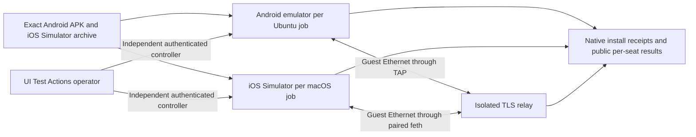

# Distributed Smart Lobby device lab

The distributed mode uses one disposable device per GitHub-hosted job. The
first job also hosts a short-lived relay over the same carrier as the proven
two-runner lab. An Android guest joins through its dedicated emulator TAP.
The iOS app uses a Simulator on a disposable macOS VM and reaches the lab
through its paired fake Ethernet interfaces.

Each job provisions a unique IPv4 address and presents its own ephemeral TLS
certificate with a unique subject. The relay authenticates the certificates from the current
workflow attempt and binds each connection to one seat. It forwards allowed
ARP, ICMP, peer TCP and mDNS Ethernet frames. It distributes mDNS multicast
within the roster and preserves the native DNS answers and TCP endpoints.
Ethernet and ARP addresses are mapped to per-seat MAC aliases so factory MAC
reuse across runner images cannot collapse independently provisioned seats.
DHCP, default routes, runner interfaces, and unrelated traffic stay outside
the overlay. TLS keys and controller bearers remain private.

## Run a qualification

1. Set the candidate app SHA and exact build producer. Use one Android APK and
   one Apple Silicon Simulator bundle from that source. The first distributed
   experiment uses the retained products from run 45121464371. For a new
   source, set `reuse_candidate: false` so the lab builds one fresh archive
   per platform before provisioning the roster. Each runner verifies its
   installed files against its platform's original build.
2. On the dedicated test branch, set the dispatch payload to
   `pairing: distributed`, an exact `candidate` commit, and a two-to-six-entry
   `platforms` roster. Generate a fresh 32-byte bearer as 64 lowercase hex characters per seat. Validate that format locally and put only the
   SHA-256 digests in the dispatch file, in roster order. A push modifying that
   file schedules the targeted lab. The controller pin is recorded in proof.
3. Wait for each seat's controller artifact. An Android hub starts before
   provisioning. A macOS hub provisions its own Simulator and verifies the app
   while GitHub assigns the other jobs, then starts certificate rendezvous.
   Each roster with an iOS seat allows up to 15 minutes for certificate rendezvous.
   This covers the observed 11-minute wait for the second Mac in run 45264443120.
   The native proof records the elapsed time and any missing seat numbers.
   iOS jobs also record separate timings for inventory, boot, and simulator
   process readiness. The boot command has a four-minute deadline.
   Each guest probes every other guest before its controller starts. A queued or
   failed seat leaves the run unqualified. Download controller documents privately. Use the seat
   number in the artifact/filename and its matching, distinct bearer.
4. Drive installed Parlor apps through the normal game UI, starting with host
   creation, native discovery and admission. Capture readiness and start,
   actual gameplay, and each final public screen. Store safe screenshots and
   the action timeline. Never publish room codes, keys, control documents,
   secrets, or images of hidden roles.
5. Check the proof artifacts for exact source and device installs, directed
   LAN probes, and redacted native app events. The hub's frame totals should
   show the expected native P2pKit service advertising/browsing and TCP
   directions between host and each peer. The final winner or score must
   agree on every device. Connectivity by itself is only infrastructure
   evidence. Reconnect evidence needs the same match and seats before and
   after the disruption plus legal actions after recovery.
   Pass one `--scorecard` per seat to `verify_distributed_proof.py` when
   validating a specific game from a directory with several completed
   routes. The verifier requires an advertisement from the match host to
   each peer in addition to its bidirectional TCP frames.
6. Use one controlled roster for compatible standalone and Party matches
   where the device lease permits. Retire the owned workflow when finished and
   verify its native artifacts are published before updating the matrix.

## Device controller checks

Check the reported controller capabilities on each Mac. Simulator and
desktop-window screenshots have different coordinate spaces. When using the
desktop fallback, confirm the visible Simulator geometry and scroll actions
into the viewport before tapping. A fresh disposable Mac may show the lab's
Python Local Network prompt over the Simulator. Address that prompt before
driving Parlor. Keep Parlor's own permissions and app behavior intact.

A guest displaying approval pending proves authenticated discovery and delivery
to the authority. A pass still requires successful approval, eligibility and
start, game actions, and matching results. Correlate the guest's pending
timestamp with the host's admission outcome. Allow expired requests to end
before retrying.

The iOS accessibility tree can report an approval that sits behind the fixed
lobby footer. Scroll within the roster body until the named physical button
appears above the footer. Require an authority commit and the guest's admitted
screen after the tap. [Five-seat iOS host run](https://github.com/parlor-game/parlor/actions/runs/45274208947)

The distributed UI controller exposes a bounded `parlor_transport` source via
`diagnostics.events`. It exports approved event names, guest timestamps and
reason codes from `diagnostics.REASON_CODES` on the run's exact harness
revision. Use it to diagnose admission during a live match without retiring
the runner. The native artifact still contains the final redacted timeline.
During gameplay, the lab also samples ICMP in both directions between the
hub and each edge and records seat IDs, UTC seconds, and replies. Compare
that timeline with native socket events when a player reconnects.

The iOS cleanup also retains redacted native crash summaries for that job's
specific Simulator and debug bundle when macOS produced an IPS report. The
summary contains the exception and termination codes plus faulting binary UUIDs
and offsets for symbolication. The launch command routes the debug app's
console to job-private files. Cleanup can extract an uncaught Kotlin exception
class and Parlor method names. Exception messages, raw stack data and private
app logs stay off the artifact.

If an Android guest reports a local-network error after a passing probe, check
its current `AndroidWifi` association in Android's Internet panel. The
isolated network has no public Internet access. A saved network can be
disconnected during a long rendezvous, so confirm a current connection and
record any manual reassociation. Let a planned interruption occur before using
that recovery step.

## Scaling bounds

- Start with Android, Android, iOS for an open three-seat Ghamza route. Scale
  to a six-job roster after that run proves discovery and gameplay. Reuse a
  six-seat lab only where the game's roster matches the support matrix.
- GitHub's published Free, Pro and Team allowance is five concurrent macOS
  jobs. Keep mixed rosters at or below five Macs, accounting for other running
  jobs. Six iOS seats need a proven two-Simulator Mac allocation plus four
  one-Simulator jobs, a higher allowance, or an authorized private lab.
- The staged Intel readiness probe held two independent SpringBoards live on
  one standard Intel runner. It creates the exact known iOS 26.2 runtime and
  waits for the first guest before booting the second. Concurrent boot and a
  separate runtime inventory attempt had timed out. The Intel app producer
  builds the exact source once, archives the checked x86_64 slice, and can feed
  the dedicated two-install test workflow. A boot receipt alone qualifies no
  gameplay. [Staged readiness](https://github.com/parlor-game/parlor/actions/runs/45287247076/artifacts/14872356866)
- A single Ubuntu runner previously ran two independent Android emulators
  through Last Light and five through Mafia. Those runs used Android's
  same-host Wi-Fi backend. A hybrid roster with two guests behind one edge
  still needs its own directed and discovery preflight. The second Simulator
  in the same-Mac iOS test failed to reach SpringBoard within 240 seconds.
  More than six devices does not add a new roster requirement today.
- A runner VPN addresses IP connectivity. It does not demonstrate guest
  multicast discovery. An alternative self-hosted lab needs an approved
  isolated L2 segment with guest-to-guest mDNS and TCP and independent
  device controls, such as coordinated Mac and KVM capacity on a private
  test VLAN.
- Simulator qualification does not cover physical camera pairing, local
  network privacy prompts, actual hotspots, or signed Store acceptance.

Hosted runs have exercised six players in one room and fourteen independent
controllers across three concurrent labs. Each lab confines discovery and
gameplay to its own roster. The larger simultaneous count measures runner
availability across separate rooms.

[GitHub Actions limits](https://docs.github.com/en/actions/reference/limits)
· [GitHub private networking](https://docs.github.com/en/actions/how-tos/manage-runners/github-hosted-runners/connect-to-a-private-network)
· [Pinned two-runner proof](https://github.com/ui-test-actions/ui-test-actions/blob/0c818c5d72e8c30c59bd1287c330a40392bf8e89/docs/mobile-lan.md)
· [Android emulator networking](https://developer.android.com/studio/run/emulator-networking-interconnect)
· [Apple local-network privacy](https://developer.apple.com/documentation/technotes/tn3179-understanding-local-network-privacy)

[Two Android guests on one runner](https://github.com/parlor-game/parlor/actions/runs/45061993861)
· [Five Android guests on one runner](https://github.com/parlor-game/parlor/actions/runs/45085087720)
· [Two-Simulator macOS result](https://github.com/parlor-game/parlor/actions/runs/45129317164)
